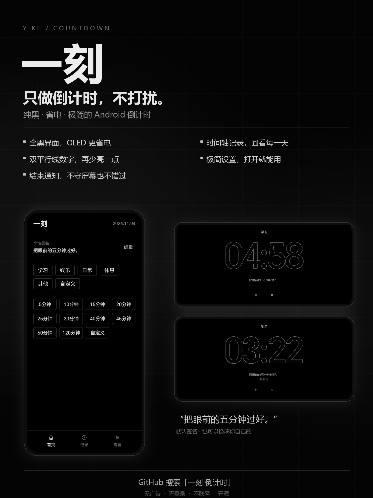
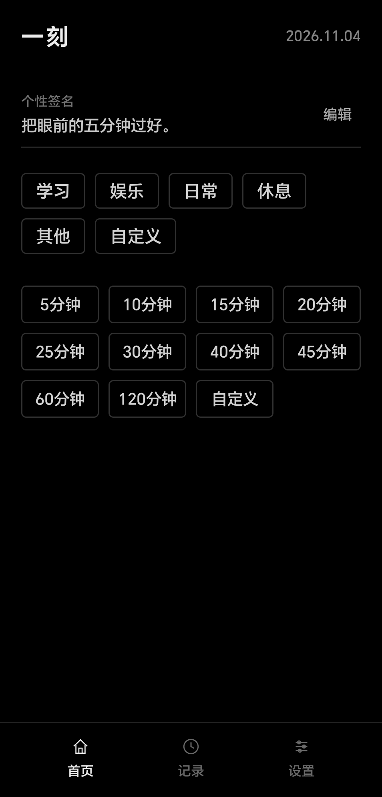
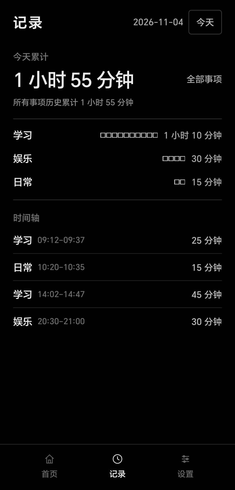
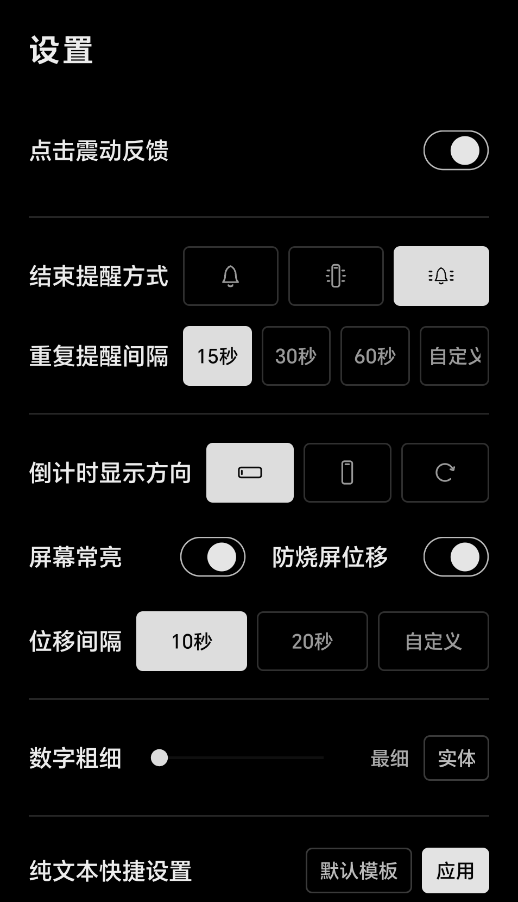
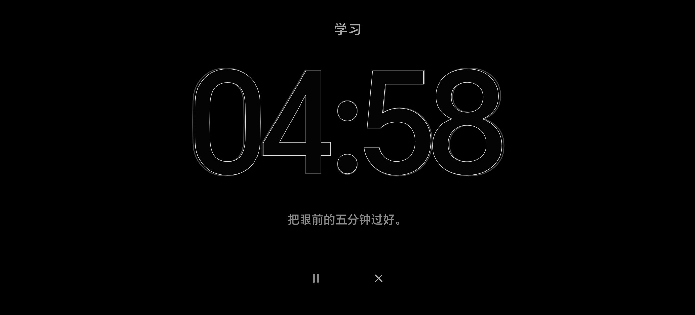
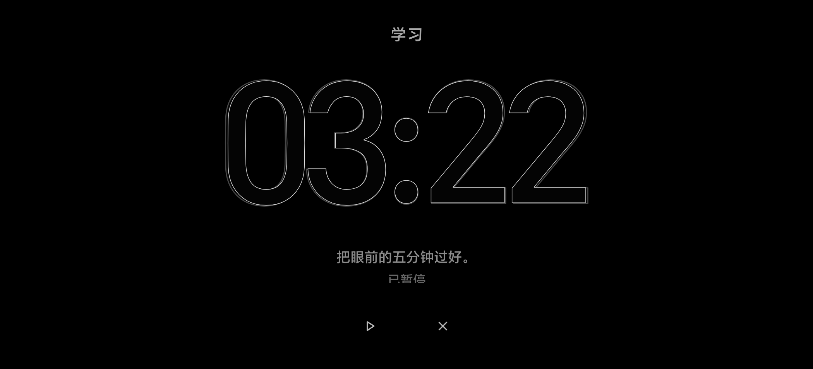
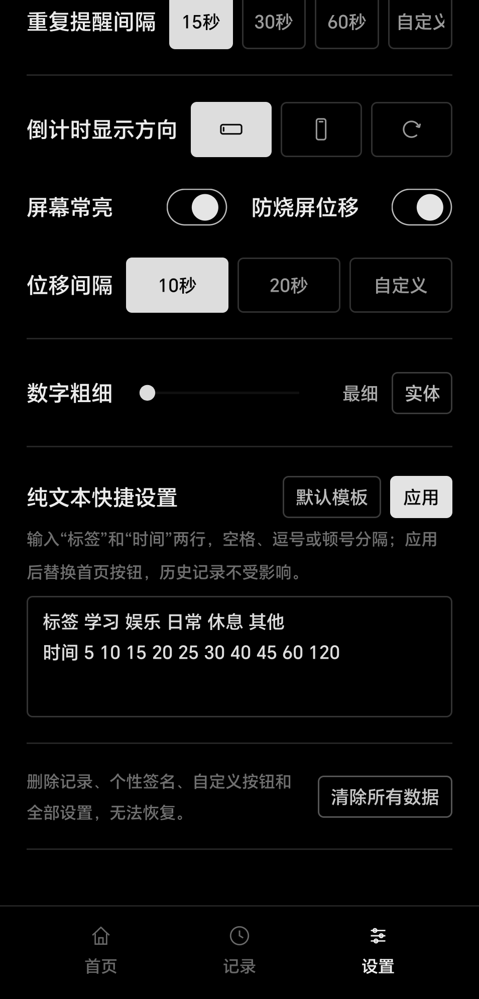

# 一刻

> 只做倒计时，不打扰。

<p align="center">
  
</p>

一刻是一款原生 Android 极简倒计时应用。打开应用，选择事项和时长即可开始；只保留计时、提醒和本地记录，没有账号、广告和社交功能。

界面以纯黑为主，适合 OLED 屏幕长时间显示。倒计时数字默认使用空心细线，可在设置中调整线条粗细，也可以切换为实体数字。

## 功能

- **纯黑界面**：全局黑色背景，夜间使用更安静，也更适合 OLED 屏幕。
- **空心数字**：默认双线空心样式，可调整粗细或切换为实体数字，兼顾辨识度与功耗。
- **结束提醒**：支持声音、震动或两者同时提醒，并可设置重复提醒间隔。
- **记录与时间轴**：按事项汇总每日时长，按天查看时间轴；长按记录可修改标签、起止时间或删除。
- **可配置事项与时长**：内置常用事项和 5–120 分钟时长，支持自定义、拖动排序和删除。
- **快捷设置**：可用纯文本批量设置事项与时长，也可一键恢复默认模板。
- **本地数据**：应用不申请联网权限，记录、设置和个性签名都保存在本机。

## 界面

| 首页 | 记录 | 设置 |
| --- | --- | --- |
|  |  |  |

<p align="center">
  
  
</p>

设置页下方还提供了纯文本快捷设置和一键恢复默认模板：

<p align="center">
  
</p>

## 使用

1. 在首页选择一个事项标签和一个时长，点击即可开始倒计时。
2. 倒计时页默认为横向显示，可在设置里切换为竖向或跟随系统；支持暂停、继续和结束。
3. 在首页长按标签或时长按钮可以拖动排序；拖到页面底部的「拖到这里删除」即可删除。
4. 在记录页长按一条记录，可以修改标签、修改起止时间或删除。
5. 设置页可以调整提醒方式、重复提醒间隔、屏幕常亮、防烧屏位移、点击震动和数字粗细等选项。

## 安装

1. 打开本仓库的 **Releases**，下载最新的 `yike.apk`。
2. 在手机上允许安装未知来源应用，然后完成安装。
3. Android 13 及以上首次启动时，请允许通知权限，否则结束提醒无法显示。
4. 后续使用同一签名的版本覆盖安装，会保留已有记录和设置。

最低支持 Android 8.0（API 26）。

## 隐私

- 应用没有声明 `INTERNET` 权限，不会联网。
- 没有账号、广告、统计或第三方 SDK。
- 记录、设置和个性签名保存在应用本地的 SharedPreferences 中，卸载应用会删除这些数据。

## 从源码构建

需要：

- JDK 21（JDK 17 也可以）
- Android SDK Platform 35
- Android SDK Build-Tools 35.0.0
- Python 3

```bash
export ANDROID_SDK=/path/to/android-sdk
bash android/build.sh
```

产物为 `android/build/yike.apk`。构建脚本不依赖 Gradle，直接调用 `aapt2`、`javac`、`d8`、`zipalign` 和 `apksigner`。

本地首次构建时，如果 `android/yike.keystore` 不存在，脚本会自动生成一个测试签名。后续升级必须使用同一个签名，也可以显式传入自己的签名信息：

```bash
KEYSTORE_PATH=/path/to/release.keystore \
KEYSTORE_PASSWORD=your-store-password \
KEY_ALIAS=your-alias \
KEY_PASSWORD=your-key-password \
bash android/build.sh
```

## 自动发布

推送 `v*` 标签（例如 `v1.0.1`）会触发 [Release APK](.github/workflows/release.yml) 工作流：GitHub Actions 编译并签名 APK，然后创建对应的 GitHub Release。也可以在 Actions 页面手动运行并填写发布标签。

签名文件和密码保存在仓库 Secrets 中，不会提交到仓库。

## 技术实现

- 原生 Java + Android framework Views，不使用 WebView、Compose、AndroidX 或 Gradle。
- `minSdk 26`，`targetSdk 35`，`compileSdk 35`。
- 倒计时界面使用自定义 `DigitView` 绘制数字，支持双线空心、实体填充、字重调整和防烧屏位移。
- 结束提醒使用 `AlarmManager` + `Notification`，并在应用内提供震动提醒。
- APK 约 70 KB。

## 目录

```
android/
  src/com/yike/timer/      Java 源码
  res/                     资源与图标
  AndroidManifest.xml
  build.sh                 无 Gradle 构建脚本
  add_dex.py               将 classes.dex 写入 APK
docs/images/               README 与海报素材
marketing/                 发布文案
.github/workflows/         自动构建与 Release
```

## 反馈

遇到问题或有改进建议，欢迎在 [Issues](https://github.com/XiaoyuZhuang/yike-timer/issues) 中反馈。
